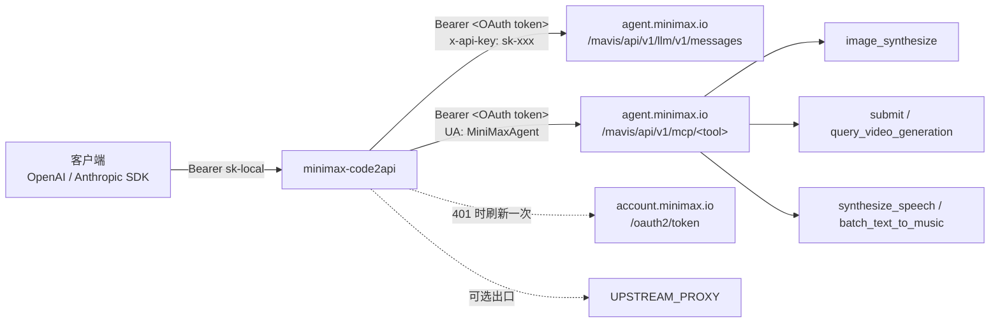

# minimax-code2api

把 **MiniMax Code 桌面端（Coding Plan 额度）** 变成标准的 HTTP 接口，同时提供
**OpenAI Chat Completions** 和 **Anthropic Messages** 两种协议。任何能配
`base_url` + `api_key` 的客户端都能直接接进来，不用改代码。

- 一个进程，两个协议：`/v1/chat/completions`（OpenAI）、`/v1/messages`（Anthropic）
- 流式、工具调用（function calling）、思考内容（`reasoning_content`）全支持
- 13 个模型一次性列全（8 对话 + 5 多模态），M3 / M3.1-Flash 是 **512K 上下文 / 128K 输出**
- **多模态同一条通道**：文生图、文/图生视频、TTS、音乐，一起变成 HTTP 接口
- 无状态、单容器、可 Docker 部署；token 到期自动续期

---

## 一、它用的是什么通道

不是 MiniMax 开放平台的 API Key，而是桌面端登录后的 **托管通道**（managed-login）。

| 项目 | 事实 | 依据 |
|---|---|---|
| 上游协议 | Anthropic Messages（不是 OpenAI） | 客户端 `config.yaml`：`@ai-sdk/anthropic` |
| 上游地址 | `https://agent.minimax.io/mavis/api/v1/llm/v1` | 同上，`en-prod` 预设 |
| 鉴权 | `Authorization: Bearer <OAuth accessToken>` **且** `x-api-key: sk-xxx` | 反编译 `local-model-resolver.js`，实测通过 |
| `x-api-key` 为什么是 `sk-xxx` | 这是客户端写死的占位符，缺了会返回 `token is required` | `MANAGED_PROVIDER_API_KEY_PLACEHOLDER` |
| Token 来源 | 设备码 OAuth，`client_id=mcode-public`，`scope=agent.default`，`audience=agent-backend` | `@mavis/oauth-core`，已在本机复现 |
| Token 有效期 | 12 小时，带 refresh token 可续 | `auth.json` 的 `expiresAtMs` |
| 计费 | 走账号 Credits，**不是按 token 计费的 API 额度** | 桌面端左下角 Credits 余额 |

### 可用模型（清单直接取自上游 provider config）

`GET https://agent.minimax.io/mavis/api/v1/models` 是这个通道自己的权威清单：`providers[0].config`
里的 `whitelist` 和 `model_order` **都只有两个** —— `MiniMax-M3.1-Flash` 和 `MiniMax-M3`
（512K 上下文 / 128K 输出，输入支持文本 + 图片 + 视频）。两者的 `context_window_options` 还带一个
`1000000`（标注 `higher_usage`），网关不透传该选项，所以对外按 512K 报。
M2.7 / M2.5 已不在白名单，但**实测仍返回 200 和真实补全**，保留为 `legacy`；
M2 / M2.1 是真的下线了（`404 The model "MiniMax-M2" is no longer available. (2069)`），默认不列出。

| 模型 | 类型 | 上下文 | 最大输出 | 输入 | 思考 | 实测结果 |
|---|---|---|---|---|---|---|
| `MiniMax-M3.1-Flash` | 对话 | 512,000（另有 1M 选项） | 128,000 | 文本/图片/视频 | **强制开启** | `200`，白名单 + 默认 |
| `MiniMax-M3` | 对话 | 512,000（另有 1M 选项） | 128,000 | 文本/图片/视频 | 可切换 | `200`，白名单 |
| `MiniMax-M2.7` / `-highspeed` | 对话 | 204,800 | 131,072 | 文本 | 可切换 | `200`，非白名单 |
| `MiniMax-M2.5` / `-highspeed` | 对话 | 204,800 | 131,072 | 文本 | 可切换 | `200`，非白名单 |
| `MiniMax-M2` / `M2.1` / `M1` / `Text-01` | 对话 | — | — | — | — | `404 ... no longer available (2069)` |
| `minimax-image` | 图像 | — | — | 文本/图片 | — | `POST /v1/images/generations` |
| `minimax-speech` / `minimax-music` | 语音 | — | — | 文本 | — | `/v1/audio/speech`、`/v1/music/generations` |
| `MiniMax-H3` / `MiniMax-H3-Max` / `MiniMax-Hailuo-2.3` | 视频 | — | — | 文本/图片 | — | `POST /v1/videos/generations` |

`GET /v1/models` 默认列出 **12 个**（6 对话 + 6 多模态），每条带 `type`、`context_length`、
`capabilities`、`legacy`；只要对话模型就加 `?include_media=0`。

**这就是这条通道的全部模型面**：图像、语音、音乐三条链路的上游工具**没有 `model` 参数**
（图像只有 `prompt` / `reference_images` / `aspect_ratio` / `area`，TTS 只有 `voice_id`），
模型由后端默认路由；唯一能在参数层换模型的是视频。想用 `image-01`、`image-01-live`、
`MiniMax-H3-Image-Highspeed` 这些，只能直连开放平台 `POST /v1/image_generation` 自己带 `model`。

**调试时怎么选**：

| 场景 | 选它 | 原因 |
|---|---|---|
| 通用对话、写代码、长文档 | `MiniMax-M3.1-Flash` | 默认值，512K 上下文，思考强制开 |
| 要低延迟 / 省钱 | `MiniMax-M3` + `"thinking":{"type":"disabled"}` | 唯一允许关思考的大上下文模型（M3.1-Flash 关掉会被上游 2013 拒绝） |
| 高并发小任务（分类、抽取） | `MiniMax-M2.5-highspeed` | 快，204K 够用 |
| 看图 / 看视频 | `MiniMax-M3.1-Flash` 或 `MiniMax-M3` | 只有这两个收图，输入模态含 `video` |

```bash
# 模型清单 + 元数据（上下文、模态、是否支持关思考）
curl -s -H "X-API-Key: $KEY" http://127.0.0.1:8080/v1/models | python -m json.tool

# 同一个请求换模型：只改 model 一行
curl -s http://127.0.0.1:8080/v1/chat/completions -H "Authorization: Bearer $KEY" \
  -H 'content-type: application/json' \
  -d '{"model":"MiniMax-M3","thinking":{"type":"disabled"},"max_tokens":64,
       "messages":[{"role":"user","content":"hi"}]}'
```

别名可用：`m3`、`m3.1`、`m2.7`、`m2.5`、`minimax`、`default`。不在表里的 id 会**原样转发**给上游
（例如 `MiniMax-M3.1`、`MiniMax-M3-flash` 实测也能出结果），所以新模型上线不必等网关发版。

### 多模态能力（同一条通道，另一组端点）

| 能力 | 上游工具 | 网关端点 | 实测状态 |
|---|---|---|---|
| 文生图 / 图生图 | `image_synthesize` | `POST /v1/images/generations`（**Ark / Seedream 协议**） | ✅ 200，1 张 1K 实测 27–94 秒（随上游负载波动） |
| 文生视频 / 图生视频 | `submit_video_generation` + `query_video_generation` | `POST /v1/videos/generations` | ✅ 提交成功（202 + task_id），查询状态流转 `running → succeeded`；**文件交付环节见 §3.7** |
| 语音合成 | `synthesize_speech` | `POST /v1/audio/speech` | 端点与参数已验证；实测时余额已耗尽（402） |
| 音色列表 | `get_voice_list` | `GET /v1/audio/voices` | ✅ 200，332 个音色 |
| 音乐 / BGM | `batch_text_to_music` | `POST /v1/music/generations` | 端点与参数已验证；同上受余额限制 |
| 图片 / 视频 / 音频理解 | `images_understand` 等 | 暂未封装 | 上游要的是本地 workspace 路径，需先做文件上传，见下方边界 |

视频模型：`MiniMax-H3`、`MiniMax-Hailuo-2.3`。

---

## 二、30 秒跑起来（本机已登录桌面端）

```bash
git clone https://github.com/rsfree/minimaxcode2api-com.git && cd minimaxcode2api-com
python -m venv .venv && .venv/bin/pip install -r requirements.txt   # Windows: .venv\Scripts\pip

GATEWAY_API_KEY=sk-local .venv/bin/python -m uvicorn app.main:app --host 0.0.0.0 --port 8080
```

macOS / Linux 会自动读取桌面端的 `~/.minimax/auth/prod/en/mcode-public/auth.json`，
**不需要手动复制 token**。桌面端每次刷新 token，网关下一次请求就跟着用新的。

```bash
curl -s http://127.0.0.1:8080/v1/chat/completions \
  -H "Authorization: Bearer sk-local" -H "Content-Type: application/json" \
  -d '{"model":"MiniMax-M3.1-Flash","messages":[{"role":"user","content":"你好"}]}'
```

服务器部署请看 **[DEPLOY.md](DEPLOY.md)**（含出口网络要求、Docker、反代、排障）。

不想自己构建就用现成镜像，每次 push 自动构建并跑过冒烟才推上去：

```bash
docker pull ghcr.io/rsfree/minimaxcode2api-com:latest
```

tag 有三个：`latest`、`master`、`sha-<7位>`（打 `v*` 标签时另有 semver）。
镜像页在仓库右侧 **Packages**，或直接访问
[ghcr.io/rsfree/minimaxcode2api-com](https://github.com/rsfree/minimaxcode2api-com/pkgs/container/minimaxcode2api-com)。

---

## 二点五、多账号池（多份额度轮着用）

一个账号的额度有限。网关支持把多个账号放进 `TOKEN_POOL`，请求按轮询分摊，
某个号 401/402/429 就自动停用一段时间再换下一个，不会把整个网关拖死。

### 建池

邮箱 + 密码即可，**不需要浏览器、不需要验证码、不需要邮箱收信**：

```bash
# 单个账号
python -m app.provision --email someone@mail.example --password 'secret'

# 批量：accounts.txt 每行 "邮箱<tab>密码"（空格分隔也行）
python -m app.provision --file accounts.txt

# 手工续期池里所有 token（平时不用跑，网关会自己续）
python -m app.provision --refresh
```

生成的文件长这样，一个账号一个文件：

```json
{
  "region": "en",
  "email": "someone@mail.example",
  "username": "MiniMax322212",
  "user_id": "576841688080293888",
  "group_id": "2120731921469153576",
  "accessToken": "mmoat_...",
  "refreshToken": "mmort_...",
  "expiresAtMs": 1794511512549
}
```

> `refreshToken` 每次续期都会轮换，网关会就地写回文件，**不要手工拷贝旧值**。

### 网页加号：在控制台里贴账号

`/ui → 账号池 → ＋ 添加账号`，把 `邮箱 密码` 一行一个贴进去就行（空格 / Tab / 逗号都认），
一次最多 200 个。后台串行分组去换 token，逐个回显「已加入 / 已更新 / 失败 + 原因」，
写完立刻进池，不用重启、不用 SSH。

背后就是同一套流程，也有接口：

```bash
curl -s -H "X-API-Key: $KEY" -H 'content-type: application/json' \
  -d '{"text":"a@mail.example pw1\nb@mail.example pw2"}' \
  http://127.0.0.1:8080/admin/accounts/import
# → {"job": {"state": "running", "total": 2, "rows": [...]}}

curl -s -H "X-API-Key: $KEY" http://127.0.0.1:8080/admin/accounts/import   # 轮询进度
```

- **一次只跑一个导入任务**（登录接口有速率限制，并发开多像撞库），并发数默认 3，
  用 `PROVISION_CONCURRENCY` 调；
- 密码只在内存里过一遍，**不落盘、不进日志**，写进目录的只有 access/refresh token；
- 同一邮箱再提交一次等于重新授权并覆盖旧 token 文件（回显「已更新」），不会出现两个同号；
- 失败原因会区分「登录被拒 / 没有可授权分组 / 超时」，一个号失败不影响整批。

### 启动

```bash
TOKEN_POOL=./data/tokens UPSTREAM_PROXY=http://127.0.0.1:7890 \
GATEWAY_API_KEY=sk-local python -m uvicorn app.main:app --port 8080
```

### 扩容：加号不用重启

`TOKEN_POOL` 目录默认**每 10 秒扫一次**：新写进去的账号文件自动进池、被删掉的文件自动退池，
不用 restart，也不会打断正在跑的请求。

```bash
# 1) 把新号写进网关正在用的那个目录
python -m app.provision --email new@mail.example --password 'secret'
#    Docker 部署就写卷里的同一路径，一次性的临时容器即可：
#    docker compose run --rm --entrypoint python minimax-code2api \
#      -m app.provision --email new@mail.example --password 'secret' --out /data/tokens

# 2) 10 秒后看池子（不用重启）
curl -s -H "X-API-Key: $KEY" http://127.0.0.1:8080/healthz |
  python -c "import json,sys;d=json.load(sys.stdin);print(d['pool_size'],[a['label'] for a in d['accounts']])"
```

日志里会出现 `pool: +1 account xxx` 和 `pool reloaded: 9 account(s) (+1/-0)`。

- 热加载做**新增 / 移除**；已在内存里的账号保留计数、冷却和停用标记，但凭证以**磁盘为准**——
  只要文件里的 `accessToken` 比内存新（`expiresAtMs` 更晚），就采纳它。原因见下面「续期」；
- 扫描间隔由 `TOKEN_POOL_WATCH` 控制（秒，默认 `10`，填 `0` 关掉）；
- 想按账号下线，直接 `rm` 对应 json 即可，正在进行的请求不受影响。

### 续期

`accessToken` 12 小时过期（`expires_in=43200`），`refreshToken` **一次性轮换**：换一次，
旧值立刻 `invalid_grant`，**而且上游把「复用旧 refresh token」当成凭证泄露，会连带吊销刚发出来的 access token**
（实测：第二次用旧值换失败后，几秒前刚拿到的 access 也变成 `invalid token`）。
所以刷新有两个写者——网关的 `renew` 和签到线程（直接读写文件）——文件是它们共享的真相，内存只是缓存，
顺序永远是**先看磁盘、再决定是否换**：

1. 请求前发现 `expiresAtMs` 已过（提前 120 秒）→ **先重读该账号的 json**；文件里已有更新的凭证就直接用，
   绝不再拿旧 refresh token 去换（换一次就等于把会话做掉）；
2. 磁盘也没有更新值时，用内存里的 `refreshToken` 换新，**原子写回**该账号的 json；
3. 上游回 `401` → 先重读磁盘（通常是签到线程刚轮换过），采纳后重试一次；磁盘无变化才 `renew`；
4. `_pool_watch_loop` 每 10 秒和签到跑完各同步一次：文件里的 `expiresAtMs` 比内存晚就采纳，
   计数、冷却、停用标记保留在内存对象上；
5. 签到**不会自己换 token**：网关先在有锁的路径上把快过期的号续好（`pre-check-in renewal`），
   再让签到线程只读文件。否则两边同时换同一个 refresh token，必有一方 `invalid_grant`，
   而 reused token 会连带吊销整个会话。

**唯一不会自动恢复的情况**：`refreshToken` 本身被拒（密码改过、上游吊销）。
密码不落盘（`write_record` 会剔除 `password`），所以这时只能重新加号。

### 看池状态

`GET /healthz` 不返回任何 token，但**会列出每个账号的 label（邮箱）**，所以它和业务接口一样要带密钥；
只有容器本机的健康检查（`127.0.0.1`）免鉴权：

```bash
curl -s -H "X-API-Key: $KEY" http://127.0.0.1:8080/healthz | python -m json.tool
```

```json
{
  "status": "ok",
  "pool_size": 8,
  "accounts": [
    {"label": "someone@mail.example", "usable": true, "uses": 12,
     "cooling_for": 0, "last_error": null}
  ]
}
```

### 失效行为

| 上游返回 | 网关动作 |
|---|---|
| `401` | 先尝试刷新一次；仍失败则停用该账号 10 分钟，换下一个 |
| `402` / `429` | 停用 15 分钟 / 1 分钟，换下一个 |
| `400 unknown model` | 该号没有这个模型的权限，换下一个账号重试 |
| `307` 跳转 | 直接报配置错误，提示换出口代理（跳转会丢 Authorization） |

全池都不可用时才返回 `502`。所有账号的 `accessToken` 12 小时过期，但有
`refreshToken` 兜底，长期不用管。

---

## 二点六、每日签到（唯一的免费加额度方式）

账号余额用完就是 `402`，唯一不花钱的回血途径是**每日签到**。规则（2026-11-12 实测）：

| 项 | 值 |
|---|---|
| 单日奖励 | 400 积分（第 4 天、第 7 天各 1000） |
| 一轮 | 7 天，合计 **4000 积分** |
| 有效期 | 领到手起 **30 天** |
| 用途 | **仅限 MiniMax Code** 消耗，不能用于开放平台 API |
| 接口 | `GET /minimax-cloud/api/v1/signin/status` / `POST .../signin/claim`，域名 `agent.minimax.io` |

网关**默认每次启动都会替池子里所有账号签到**，之后每 6 小时补一次（幂等，
签过就跳过），日志里能看到：

```
daily check-in: 7/8 accounts, +2800 credits
```

### 撞到 1008 之后：冷却到次日，签到时自动解除

上游的免费额度是**按天**给的，所以「没余额」不是等 15 分钟就能好。网关对这类错误的行为是：

| 场景 | 冷却 | 谁会解除 |
|---|---|---|
| 对话路径 `402` / `1008 insufficient balance` | **到次日 00:10**（`SIGNIN_TIMEZONE` 的本地午夜 + 10 分钟缓冲） | 下一次签到成功时自动放回轮换 |
| 媒体一次性扣费不够（视频 320 积分等） | 900 秒 | 自己到期；一次贵的任务失败不代表文本额度也没了 |
| `401` 凭证失效 | 600 秒 | 网关自己续期 |
| `429` 被限流 | 60 秒 | 自己到期 |

全池都停在额度冷却里时，请求返回 `503 no usable account: every account is out of quota until
the daily reset at 00:10 (Asia/Shanghai)` —— 直接告诉你什么时候恢复，而不是笼统的 502。

控制台账号行会显示「冷却 至 00:10」，鼠标悬停写明原因。

手动跑或只是想看进度：

```bash
python -m app.signin --dir data/tokens            # 直接签到
python -m app.signin --dir data/tokens --status   # 只看状态，不领
```

```
aaa@mail.example.com            day 1 claimed   cycle=4000 pts
bbb@mail.example.com            day 1 claimable cycle=4000 pts

8 account(s), 2800 credits still claimable this cycle
```

关键点：`timezone_id` 必须是 IANA 名字（`Asia/Shanghai`），传偏移量 `480` 会被服务端
以 `1406010011 invalid timezone_id` 拒绝——这个坑没有文档，只有前端 bundle 里能看出来。

**规模效应**：8 个账号 × 4000/周 = **3.2 万积分/周**，足够抵消日常刷请求的消耗。
这也是多账号池真正的价值所在：单号每天 400 不够用，八个号一起签到才够。

---

## 二点七、内置控制台

浏览器打开 **`http://<host>:8080/ui`** 即可，不需要另外部署前端容器。**页面本身也要鉴权**：
没登录时返回一个登录页，输入 `.env` 里的 `GATEWAY_API_KEY`，服务端种 30 天 cookie，之后直接进。

```bash
curl -s -o /dev/null -w '%{http_code}\n' http://127.0.0.1:8080/ui          # 401 + 登录页
curl -s -o /dev/null -w '%{http_code}\n' 'http://127.0.0.1:8080/ui?key=sk-local'  # 200 并种 cookie
```

| 分组 | 页面 | 做什么 |
|---|---|---|
| 使用 | 对话 | 流式输出、思考过程折叠、耗时与 token 用量 |
| 使用 | 图像 | 文生图，结果直接预览并给 CDN 链接 |
| 使用 | 语音 | TTS，音色从 `/v1/audio/voices` 拉（332 个），合成后直接播放 |
| 运营 | 账号池 | 7 项池状态 + 异常汇总条；每号积分、成功/失败、在途、token、签到状态；搜索 / 状态筛选 / 排序 / 分页；**＋ 添加账号**（贴邮箱密码批量开通，逐行回显结果）；单号签到与禁用开关；批量签到 |
| 运营 | 用量 | 请求数、成功率、失败、输入/输出 token、P95 延迟；token 时序图；按账号 / 按模型明细 |
| 运营 | 容量规划 | 余额可撐天数、日均消耗与签到日供给、行动建议、1/3/7/14 天补号测算 |
| 观测 | 请求日志 | 每个请求的时间、结果、类型、模型、账号、耗时、token、**错误正文**、请求 ID；顶部有「近 24h 失败聚合」，**点任意一行看完整字段与报错**并一键复制；5 秒自动刷新 |
| 配置 | 模型 | 13 个模型的上下文 / 最大输出 / 能力 / 模态，可按类型与能力筛选；**在线调试**（改请求体、发真实请求、复制 cURL） |
| 配置 | 运行配置 | 生效的环境变量（密钥脱敏）、冷却时长、签到与探针间隔，只读 |

设计令牌与 [WorkBuddy2API](https://wb2api.1task.cn/panel/) 控制台同一套（冷石墨底 + 靛蓝强调、
等宽数字、明暗双主题），两个面板观感一致；分区也照它分：运营 / 观测 / 配置。

鉴权用同一个 api key：cookie（页面）和 `Authorization: Bearer` / `X-API-Key`（接口）等价，
`/ui/logout` 清掉 cookie。静态 HTML 里不含任何密钥。

### 控制台的数据从哪来

| 来源 | 内容 | 存活 |
|---|---|---|
| `app/store.py` + `/data/metrics.db` | **每个请求一行**（时间、账号、结果、耗时、token、错误、来源 IP） | 落盘，默认留 3 天，**重启不清** |
| `app/store.py`（`kind=console`） | **面板自己的失败请求**：`/admin/*` 回 4xx/5xx、抛异常、或超过 1.5 秒时记一行 | 同上；正常轮询不记，不占地方 |
| `Token` 计数器 | 每号「本进程」成功 / 失败 / 在途 | 进程内，重启归零（累计值由上一行聚合） |
| `app/probe.py` | 每号签到面板 + 积分批次（`credit/details`）+ **真实余额**（`get_membership_info`） | 缓存，每 `PROBE_INTERVAL` 秒刷一次 |

请求历史落 SQLite（标准库，WAL，后台线程批量写，单条延迟 1 秒内），落在 token 文件旁边
的 `/data` 卷上。`METRICS_DB` 可以改路径，`off` 退回纯内存；打不开时网关照常跑，
页面会写「仅内存」而不是假装有历史。

**两种计数口径不一样，这是特性不是 bug**：

| 数字 | 单位 | 在哪看 |
|---|---|---|
| 用量页「请求数 / 成功率」 | **一次客户端请求** | 一次请求重试 3 个号算 1 条 |
| 账号行「成功 / 失败」 | **一次账号尝试** | 同一个请求会同时记 A 号失败、B 号成功，所以尝试数总和 > 请求数 |

账号行的小字「累计 N · 失败 M」是含重启前的全量，上面那组是本次进程的。

#### 报错在哪看：三处，缺一不可

以前面板只会弹一句 `HTTP 502`，服务器这边查不到任何记录 —— 这不是「没问题」，而是**没有证据**。
现在失败一定留痕，分三处：

| 位置 | 内容 | 什么时候看 |
|---|---|---|
| 请求日志 → **错误 / 说明** 列 | 每行的上游报错原文（截断 800 字），失败行左侧有红条 | 某个请求为什么失败 |
| 点开任意一行 | 全字段 + 完整报错，可「复制这一行 JSON」/「只复制报错」 | 要贴给上游或工单 |
| 请求日志顶部 → **近 24h 失败聚合** | 同一句报错出现多少次、首末时间；点一下就筛出这一条 | 不是「坏了一次」而是「一直在坏」 |
| 类型列 `面板` 的行 | 面板自己调 `/admin/*` 失败（4xx/5xx / 抛异常 / 超 1.5 秒） | 面板报错但接口日志里没有对应请求 |
| 顶部 **诊断** 按钮 | 浏览器逐个打 4 个接口 + 服务器自述 + 容器 WARNING 日志 + 面板请求流水，可整份复制 | 说不清是哪一层断了 |

**判读规则**（这也是「诊断」弹层会直接告诉你的结论）：

| 现象 | 结论 |
|---|---|
| 浏览器报 502，请求日志里**没有**对应的 `面板` 行 | 请求没到网关。问题在浏览器 → 服务器之间：代理 / VPN / 端口转发 / 运营商 |
| 有 `面板` 行、状态 502、**响应体为空** | 同上。网关自己回的每个错误都带 JSON 体，空体不是它产的 |
| 有 `面板` 行、状态 0 | 连接断了但网关没回响应（进程重启、客户端中断） |
| 请求日志里有 `chat` 失败行 | 网关收到了，是上游/账号问题，看错误正文与账号列 |

对应的只读接口（都要 key）：

```bash
curl -s -H "Authorization: Bearer $KEY" "$BASE/admin/errors?hours=24&limit=8"   # 失败聚合
curl -s -H "Authorization: Bearer $KEY" "$BASE/admin/diagnostics?lines=80"      # 一键自述
```

`/admin/diagnostics` 返回版本、运行时长、区域、出口、号池、落盘状态（含写入队列与错误）、
最近 6 条失败、失败聚合、**容器日志里 WARNING 以上的最后 N 条**（等于不用 ssh 看 `docker logs`），
以及一组「怎么读这些数字」的提示。

#### 时间显示用哪个时区

控制台的时间戳按 `SIGNIN_TIMEZONE`（默认 `Asia/Shanghai`）格式化，**不依赖容器 TZ** ——
容器默认跑在 UTC，早期版本直接用 `time.localtime`，日志比北京时间慢 8 小时，看起来像坏了。
`docker compose logs` 的时间由 compose 里的 `TZ` 控制（本仓库默认也设成 `Asia/Shanghai`）。
日志表带日期（`11-12 20:24:44`），因为历史跨天。

#### 探针在做什么，花不花钱

探针**不发对话、不采样模型**。它只是把号池里每个账号自己的 `access_token` 拿去向三个
**账号侧只读接口**问几句话：

| 调用 | 拿什么 | 计费 |
|---|---|---|
| `GET /minimax-cloud/api/v1/signin/status` | 七天签到面板：今天能不能领、领多少、本周期还欠多少 | 免费 |
| `GET /minimax-cloud/api/v1/credit/details` | 有偿积分台账（买过 / 发过的包） | 免费 |
| `POST /matrix/api/v1/commerce/get_membership_info` | 真实余额、免费/付费拆分、计划名 | 免费（`POST` 但 body 是 `{}`，纯查询） |

**实测**（一个余额 399.99 的号，容器内直接跑）：

```
before          balance=399.99
after 10 sweeps balance=399.99      # 30 次上游调用，耗时 8.7s
delta = 0.0

对照：1 次真实对话 399.99 → 399.95  (−0.04)
      15 次探针    399.95 → 399.95  (0.00)
```

所以：**探针零积分消耗**，花积分的只有转发出去的对话 / 生图 / TTS / 音乐请求。
签到是**进账**（+400，第 4、7 天 +1000），不是开销。

跑一轮的代价只有上游请求数和几秒时间：

- `PROBE_AUTO=1` 时后台每 `PROBE_INTERVAL`（默认 300 秒）跑一轮，`0` 或 `PROBE_AUTO=0` 关掉自动；
- 一轮 = 账号数 × 3 个请求，4 并发。30 个号实测 **7.6 秒、0 个失败**，约 0.3 req/s；
- 结果进内存，**控制台页面不触发上游**：`/admin/overview` 读的是缓存快照，只有点「刷新探针」
  或 `POST /admin/probes/refresh` 才同步重跑一轮；
- 历史保留 288 个采样点（300 秒一轮 ≈ 24 小时），容量页的消耗速率就是这两点之间的差值。

**探针不碰账号状态机**：不 `park`、不计 `in_flight`、不改冷却。某个号查询失败只会让那一行
显示红色 `error`，**不会把号冷却掉**，业务请求照常可以用它。

一个已知限制：探针直接用号池里现成的 token，**不会主动续期**。access token 过期而还没被
业务请求触发刷新时，那一轮会报 `401`；发出一个正常请求、让 `token_manager` 续期后就恢复。

#### 两个「积分」不是一回事

| 接口 | 是什么 | 免费号的表现 |
|---|---|---|
| `GET /minimax-cloud/api/v1/credit/details` | **有偿积分台账**：买过 / 发过的包 | `total_count: 0`，没有 `details` 字段 —— 空账本，不是错误 |
| `POST /matrix/api/v1/commerce/get_membership_info` | **真实余额**：`op_credit_summary.total_remaining_amount`（免费 + 付费）、计划名、赠送 | 签到到账未花 = **400**；花完或没签 = **0** |

控制台那张「积分余额」卡片读的是**后者**，账号行的积分列也是。早期版本读台账、发现是空的就画 `—`，
看起来像坏了，其实是查错了表。

同一个响应里还有个 `total_remains_credit`，**恒为 0**（连手里握着 400 分的号也是 0），
早期按它显示就永远是空。真实可用额度只看 `op_credit_summary`。

余额为 0 **不影响**这些号继续跑：Free 计划真正的计量是「每天一份免费额度」，与积分分开算，
上游也不暴露剩余量；跑空时才回 `402 insufficient balance (1008)`，网关会把该号冷却到次日重置。

容量页的消耗速率取「余额合计」两次采样之间的差值，**不按 token 折算**：不同模型单价不同，
折算会给出假精度。采样不足时它直接说「还测不出消耗速率」，而不是编一个数字。

---

## 三、接口

### 3.1 OpenAI 协议

```
POST /v1/chat/completions
GET  /v1/models
```

```bash
# 流式
curl -N http://127.0.0.1:8080/v1/chat/completions \
  -H "Authorization: Bearer sk-local" -H "Content-Type: application/json" \
  -d '{
    "model": "MiniMax-M3.1-Flash",
    "stream": true,
    "messages": [{"role": "user", "content": "数到 3"}]
  }'
```

OpenAI 官方 SDK（只改两个值）：

```python
from openai import OpenAI

client = OpenAI(base_url="http://127.0.0.1:8080/v1", api_key="sk-local")
resp = client.chat.completions.create(
    model="MiniMax-M3",
    messages=[{"role": "user", "content": "用一句话解释 HTTP/2"}],
)
print(resp.choices[0].message.content)
```

工具调用：

```python
tools = [{
    "type": "function",
    "function": {
        "name": "get_weather",
        "description": "查询城市天气",
        "parameters": {"type": "object", "properties": {"city": {"type": "string"}}, "required": ["city"]},
    },
}]
resp = client.chat.completions.create(
    model="MiniMax-M3",
    messages=[{"role": "user", "content": "深圳天气怎么样？"}],
    tools=tools,
)
print(resp.choices[0].message.tool_calls[0].function)
# function(name='get_weather', arguments='{"city": "Shenzhen"}')
```

思考内容在 `choices[0].message.reasoning_content`，和正文分开，不会污染 `content`。

### 3.2 Anthropic 协议

```
POST /v1/messages
```

模型输出的 `thinking` 块原样保留，所以 Claude Code、Cline 这类客户端能直接看到思考过程。

```bash
curl -s http://127.0.0.1:8080/v1/messages \
  -H "Authorization: Bearer sk-local" -H "Content-Type: application/json" \
  -d '{"model":"MiniMax-M3","max_tokens":256,"messages":[{"role":"user","content":"你好"}]}'
```

```python
from anthropic import Anthropic

client = Anthropic(base_url="http://127.0.0.1:8080", api_key="sk-local")
msg = client.messages.create(
    model="MiniMax-M3.1-Flash",
    max_tokens=256,
    messages=[{"role": "user", "content": "你好"}],
)
print(msg.content[0].text)
```

接入 Claude Code 之类的工具：

```bash
export ANTHROPIC_BASE_URL=http://127.0.0.1:8080
export ANTHROPIC_AUTH_TOKEN=sk-local
export ANTHROPIC_MODEL=MiniMax-M3
export ANTHROPIC_SMALL_FAST_MODEL=MiniMax-M3.1-Flash
```

### 3.3 运维端点

| 端点 | 说明 |
|---|---|
| `GET /` | 名称、端点清单、模型列表（不需要 key） |
| `GET /ui` | **内置控制台**（使用 / 运营 / 观测 / 配置 九页），单文件零依赖；需要 key（登录页种 cookie） |
| `POST /ui/login` | 控制台登录，`key=…` 表单；`GET /ui?key=…` 也能一次性登录 |
| `GET /healthz` | 200 = 有可用凭证；503 = 缺凭证；**需要 key**，仅容器本机 127.0.0.1 免鉴权 |
| `GET /v1/models` | 全部 13 个模型（8 对话 + 5 多模态，带 `type`）；`?include_media=0` 只要对话模型 |
| `GET /v1/models/meta` | 带上下文长度、能力标记、模态 |
| `GET /v1/media/models` | 多模态能力清单（参数范围、对应端点） |
| `POST /v1/messages/count_tokens` | 粗估 token 数（上游不开放 tokenizer） |

控制台自己的后端（全部要 key，语义见上一节）：

| 端点 | 说明 |
|---|---|
| `GET /admin/summary` | 导航栏轮询用的轻量快照：池状态、24h 用量、签到合计、异常列表 |
| `GET /admin/overview` | 账号池页：每号状态/计数 + 探针结果 + 异常 |
| `GET /admin/usage?hours=24` | 聚合：total / 时序 / 按模型 / 按账号（窗口含重启前的历史） |
| `GET /admin/logs?limit=200&offset=0&q=&outcome=` | 请求日志，倒序分页；返回 `total`（匹配总数）与 `source`（`sqlite` / `memory`） |
| `GET /admin/errors?hours=24&limit=8` | 失败按报错原文聚合：次数、首次/末次时间、状态码 |
| `GET /admin/diagnostics?lines=80` | 服务器自述：版本、运行时长、号池、落盘队列、最近失败、容器告警、判读提示 |
| `GET /admin/capacity?hours=24&days=7` | 容量预测、建议、补号测算、口径说明 |
| `GET /admin/config` | 生效配置，密钥脱敏 |
| `GET /admin/models` | 模型目录（含视频模型清单） |
| `GET /admin/probes?refresh=0` / `POST /admin/probes/refresh` | 签到面板 + 积分批次缓存 / 立刻重采 |
| `POST /admin/signin` | `{"label": "..."}` 签一个号，`{}` 签全部 |
| `POST /admin/accounts/disable` | `{"label": "...", "disabled": true}` 单号停/启用（不删文件） |
| `POST /admin/accounts/import` | `{"text": "邮箱 密码\n..."}` 批量开通并进池（后台任务，一次一个）；密码不落盘 |
| `GET /admin/accounts/import` | 当前 / 上次导入任务的分账号进度（控制台轮询这个） |

### 3.4 文生图（Ark / Seedream 协议）

```
POST /v1/images/generations
```

请求与响应都按火山方舟（Volcengine Ark）`POST /api/v3/images/generations` 的形状来：
**只改 `base_url` 和 key**，把 Seedream 客户端指过来就能跑。

```bash
curl -s http://127.0.0.1:8080/v1/images/generations \
  -H "Authorization: Bearer sk-local" -H "Content-Type: application/json" \
  -d '{
    "model": "doubao-seedream-5-5-261028",
    "prompt": "充满活力的特写编辑肖像，工作室灯光效果强烈",
    "size": "2K",
    "output_format": "png",
    "response_format": "url",
    "watermark": true
  }'
```

```json
{
  "model": "doubao-seedream-5-5-261028",
  "created": 1794452319,
  "data": [
    {
      "url": "https://agent-cdn.minimax.io/mcp/u576.../image_tool/output/1794452319_8d06712a.png",
      "output_format": "jpeg",
      "size": "2048x2048"
    }
  ],
  "usage": {
    "generated_images": 1,
    "output_tokens": 16384,
    "total_tokens": 16384
  }
}
```

#### 请求字段

| 字段 | 网关行为 |
|---|---|
| `model` | **必填项不校验，取值一律忽略**：回显到响应里，没传填 `minimax-image` |
| `prompt` | 必填；缺失或空白 → `400 prompt is required` |
| `image` | 支持 `string` 或 `string[]`。公网 URL 直传；`data:image/...;base64,` 先上传到通道 CDN 再喂给工具，裸 base64 也认 |
| `size` | 档位 `1K` / `1.5K` / `2K` / `3K` / `4K`，或 `宽x高`。**是建议值**，换算见下 |
| `response_format` | `url`（默认）或 `b64_json`，都支持；其它值 → `400` |
| `sequential_image_generation` + `sequential_image_generation_options.max_images` | 支持：`auto` 时按 `max_images` 出图，范围 1–15 |
| `n` | OpenAI 兼容保留，1–15（优先级低于上面的 `max_images`） |

以下字段 Ark 客户端默认会带，**网关接受但忽略**（不报错），响应用实际值回答：

| 字段 | 忽略原因 |
|---|---|
| `output_format` | 工具固定产出 JPEG（扩展名与 `Content-Type` 都谎称 png），改不了 |
| `background` | 工具不支持生成透明通道；`transparent` 不会生效 |
| `watermark` | 上游固定写入 AIGC 水印 Exif，关不掉 |
| `stream` | 始终返回非流式 JSON |
| `layer_decomposition` / `layer_decomposition_options` | 工具没有图层拆分能力 |
| `optimize_prompt_options` | 提示词优化由上游内部决定 |
| `tools`（`web_search`） | 工具没有联网搜索入参 |
| `safety_identifier` | 通道没有该透传字段 |

#### `size` 怎么换算

上游只有三个面积档 `1K` / `2K` / `4K`，和九个宽高比，所以：

| 传入 | 处理 |
|---|---|
| `1K` → `4K` | 直接用 |
| `1.5K` | 落到 `2K`（面积更近） |
| `3K` | 落到 `4K`（面积更近） |
| `宽x高` | 先按比例吸附到最近的宽高比，再按面积（`2 MP` / `8 MP` 为界）选档 |
| 非法值 | `400 invalid size` |

**返回值才是真相**：`data[].size` 和 `data[].output_format` 由网关读取图片字节得出，不是照抄请求。
实测 `resolution=1K` + `aspect_ratio=1:1` → `1024×1024`；`4K` + `16:9` → `5504×3072`；
`3:2` 档位 → `1264×848`。要精确像素，上游做不到，只能拿到最接近的一档。

`usage.output_tokens` 按 Ark 的口径算：`sum(宽×高) / 256` 取整。

⚠️ **`data[].url` 的后缀是 `.png`、CDN 的 `Content-Type` 也是 `image/png`，但实际字节是 JPEG**
（`ff d8 ff e1`，带 AIGC 水印 Exif）。对比过：传不传 `output_file` 完全一样，不是文件名带偏的。
**按文件头判断格式**，响应里的 `output_format` 就是网关读文件头得到的答案。

**成本：一张 1K 图 = 115 credits**（实测某号 277.4 → 162.4）。4K 是 1K 的 17 倍面积，价格更高；
余额不够时上游直接回 `402`，文案里会出现 `plan balance has run out`。

#### 这里的「模型名」是什么

`minimax-image` 只是网关给这条链路起的**别名**，不是上游模型。整条链路没有模型选择：

| 层 | 实际名字 |
|---|---|
| 网关对外（`/v1/models` 里的 id） | `minimax-image` |
| 上游 MCP 工具 | `matrix_generate_image`（`endpoint: "image_synthesize"`） |
| 上游入参 | 只有 `prompt` / `input_files` / `input_urls` / `aspect_ratio` / `resolution`，**没有 `model`** |

上游工具清单（`GET {mcp_base}/tools`）里 `matrix_generate_image` 的 `input_schema_json` 是
`additionalProperties: false`，压根没有模型字段；出图返回里也没有模型标识，`clean_oss_key`
一律是 `.../image_tool/output/...`。所以：

- 请求体里的 `model` **完全被忽略**——传 `doubao-seedream-5-5-261028`、`minimax-image`、
  `h3-image` 结果都一样，响应只是回显你传的名字；
- **`h3-image` 在这条通道不存在**。`H3` 是**视频**模型（`MiniMax-H3` → `matrix_gen_videos`），
  和图像无关；
- 图像风格/画质只能通过 `prompt`、`size`（换算成 `aspect_ratio` + `resolution`）控制。

### 3.5 文生视频 / 图生视频

视频是**异步**的：提交拿 `task_id`，再轮询。上游没有 OpenAI 式的视频协议，这里用 REST 风格自定义。

```bash
# 1) 提交
curl -s http://127.0.0.1:8080/v1/videos/generations \
  -H "Authorization: Bearer sk-local" -H "Content-Type: application/json" \
  -d '{"model":"MiniMax-Hailuo-2.3","prompt":"a cat walking on grass","duration":6,"resolution":"768P"}'
# → 202 {"id":"462436026450282","status":"submitted","model":"MiniMax-Hailuo-2.3", ...}

# 2) 轮询（model 必须和提交时一致）
curl -s "http://127.0.0.1:8080/v1/videos/generations/462436026450282?model=MiniMax-Hailuo-2.3" \
  -H "Authorization: Bearer sk-local"
# → {"status":"running", ...} → {"status":"succeeded","video_url":"https://..."}
```

| 模型 | 时长 | 分辨率 | 计费 | 特点 |
|---|---|---|---|---|
| `MiniMax-H3` | 4–15 秒（整数） | `768P` / `2K`（默认 2K） | 4 秒实测报价 **320 credits** | 质量最好，原生同步音频，支持首尾帧 + 多模态参考（图 1-9、视频 1-3、音频 1-3） |
| `MiniMax-H3-Max` | 5–15 秒（整数） | `480P` / `768P`（**不支持 2K**） | 5 秒 480P 实测报价 **250 credits** | H3 的高速版，约 20 秒出片 |
| `MiniMax-Hailuo-2.3` | 仅 `6` 或 `10` 秒 | `768P` / `1080P`（1080P 只支持 6 秒） | 走 legacy Token Plan 额度 | 只吃一张首帧图，打包账号实际能跑的就是这条（也是默认模型） |

H3 和 H3-Max **不吃 legacy Token Plan 额度**，只从 M Plan 周额度或账号积分扣；不够就回
`402 the remaining M Plan weekly limit and account credits cannot cover this MiniMax-H3 video generation ...
this task costs 250 credits`。所以免费号上想跑 H3 只能靠账号里剩下的积分。

请求字段：

| 字段 | 说明 |
|---|---|
| `prompt` | 必填，H3 / H3-Max ≤7000 字符，Hailuo-2.3 ≤3000 字符（H3 系还会驱动原生音轨） |
| `image` | 首帧图（公网 URL）。Hailuo-2.3 只接受一张；H3 系可用 `reference_type: first_frame / last_frame` |
| `last_frame_image` | 尾帧图，**仅 H3 / H3-Max**，且必须先给首帧 |
| `reference_images` / `reference_videos` / `reference_audios` | **仅 H3**，公网 URL 数组（图 1-9、视频 1-3、音频 1-3，合计 ≤12），不能与首尾帧混用 |
| `ratio` | `21:9 16:9 4:3 1:1 3:4 9:16 adaptive`，**仅 H3 / H3-Max**；纯文本模式必须给具体比例，不接受 `adaptive` |
| `resolution` | H3：`768P` / `2K`（默认 2K）；H3-Max：`480P` / `768P`（默认 768P，**无 2K**）；Hailuo：默认 `768P`，`1080P` 仅 6 秒 |

#### 多账号池下的两个坑（网关已处理）

1. **视频权限是按账号给的**，不是按 API key。同一份代码、同一个模型，8 个号里
   只有 1 个能提交成功，其余返回
   `{"code":503,"message":"video generation is temporarily unavailable"}` ——
   这句 "temporarily unavailable" 会让人以为是上游故障，其实是**这个号没有视频能力**。
   网关遇到 `503` 会自动换下一个账号重试（生图 / TTS / 音乐同理，只有
   `query_video_generation` 的 503 才是真的"文件还没备好"，不换号）。
2. **异步任务属于提交它的那个账号**。用别的号去查，即使 `task_id` 完全正确也会回
   `404 task was not found or does not belong to the current caller`。
   网关在进程内记住 `task_id → 账号` 的映射，轮询时钉住原账号。

> 由此带来的限制：`task_id` 的归属只存在内存里，**重启网关后旧任务就查不了了**
> （会回 404 并在 `hint` 里说明）。要长期可查，得把映射落盘。

另外实测这条通道的视频**只渲染不交付**：状态会正常走到 `running` 然后变
`503 the video is ready but could not be prepared for delivery`，连查 5 分钟都拿不到
`video_url`。这不是网关问题，是上游没把文件备到可下载位置 —— 继续查同一个 `task_id`，
**不要重新提交**（会再扣一次 320 credits）。

### 3.6 语音合成 / 音乐

```bash
# 音色列表（332 个）
curl -s http://127.0.0.1:8080/v1/audio/voices -H "Authorization: Bearer sk-local"

# TTS，直接返回 mp3 字节流（OpenAI /v1/audio/speech 同样式）
curl -s http://127.0.0.1:8080/v1/audio/speech \
  -H "Authorization: Bearer sk-local" -H "Content-Type: application/json" \
  -d '{"input":"hello world","voice":"English_expressive_narrator","speed":1.0}' > out.mp3

# 音乐 / BGM（prompt 长度 10–300 字符）
curl -s http://127.0.0.1:8080/v1/music/generations \
  -H "Authorization: Bearer sk-local" -H "Content-Type: application/json" \
  -d '{"prompt":"upbeat lofi hip hop with warm piano, 90 bpm"}'
```

TTS 额外支持 `emotion`（`happy` / `sad` / `angry` / `fearful` / `disgusted` / `surprised` / `neutral`）、
`volume`、`pitch`。**只输出 mp3**：上游不提供其它容器格式，要 `wav` 请自行转码。

### 3.7 多模态的错误语义

上游把业务码塞在 HTTP 200 里，网关把它们翻成真正的 HTTP 状态，并**原样保留上游文案**：

| 上游 `code` | 网关 HTTP | 含义 | 能做什么 |
|---|---|---|---|
| `402` | 402 | 账号额度耗尽（文案会明确说 plan balance has run out） | 充值，重试无用 |
| `503`（视频查询） | 503 + `status: succeeded` + `retryable: true` | 任务已渲染完成，但服务端没备好文件交付 | 继续轮询同一个 `task_id`，**不要重新提交** |
| `401` | 401 | token 失效 | 网关会自动刷新一次 |

视频任务的 `status` 取值：`submitted` / `queued` / `running` / `succeeded` / `failed` / `cancelled`。

---

## 四、请求链路



网关本身无状态：凭证只从环境变量 / `token.json` / 桌面端 `auth.json` 读，不落日志、不下发。

---

## 五、环境变量

| 变量 | 默认 | 说明 |
|---|---|---|
| `GATEWAY_API_KEY` | 空 | 调用方要带的 key，逗号分隔多个。**公网部署必须设** |
| `MINIMAX_REGION` | `en` | `en`（国际站）或 `cn`（国内站） |
| `UPSTREAM_PROXY` | 空 | 上游出口代理。**国内网络必须设**，见 DEPLOY.md 第一节 |
| `UPSTREAM_TRANSPORT` | `auto` | `auto` / `httpx` / `curl`。出口代理会重置 Python TLS 握手时用 `curl`；`auto` 下退回 curl 只维持 5 分钟，之后自动重试 httpx |
| `TOKEN_POOL` | 空 | **多账号池目录**，一个账号一个 json。设了就优先用它轮询 |
| `TOKEN_POOL_WATCH` | `10` | 号池目录扫描间隔（秒）。新账号自动进池，`0` 关闭热加载 |
| `PROVISION_CONCURRENCY` | `3` | 控制台「＋ 添加账号」同时开通几个号（登录接口会限流，别开大） |
| `SIGNIN_AUTO` | `1` | 有 `TOKEN_POOL` 时每次启动 + 每 6 小时自动签到领积分 |
| `SIGNIN_TIMEZONE` | `Asia/Shanghai` | 签到时区，必须是 IANA 名字，不能是 `480` 这种偏移 |
| `SIGNIN_INTERVAL_HOURS` | `6` | 自动签到的检查间隔（最小 10 分钟） |
| `METRICS_DB` | 空 | 请求历史落盘路径，空 = `/data/metrics.db`（容器内）；`off` = 只在内存 |
| `METRICS_RETENTION_DAYS` | `3` | 请求历史保留天数，超期在启动时和每 6 小时清一次 |
| `TZ` | `Asia/Shanghai` | 容器时区，只影响 `docker compose logs`；控制台时间按 `SIGNIN_TIMEZONE` |
| `MINIMAX_ACCESS_TOKEN` | 空 | 直接给一个 access token（约 12h 失效） |
| `MINIMAX_REFRESH_TOKEN` | 空 | 只给 refresh token，网关自己续期 |
| `TOKEN_STORE` | `/data/token.json` | 网关自己管理的 token 文件，会就地刷新 |
| `MINIMAX_AUTH_FILE` | 自动探测 | 桌面端 `auth.json` 路径 |
| `MINIMAX_BASE_URL` | 按区域 | 上游 LLM 地址 |
| `MINIMAX_MCP_BASE` | 由 `MINIMAX_BASE_URL` 推导 | 上游多模态 MCP 代理地址，默认把 `/llm/v1` 换成 `/mcp` |
| `DEFAULT_MAX_TOKENS` | `8192` | 客户端没传 `max_tokens` 时用 |
| `UPSTREAM_TIMEOUT` | `600` | 上游超时（秒） |
| `REQUEST_BODY_LIMIT` | 64 MiB | 请求体上限 |
| `EXPOSE_RETIRED_MODELS` | `0` | 设为 1 时把已下线模型也列出来 |

---

## 六、常见问题

| 现象 | 原因 | 处理 |
|---|---|---|
| `307` 后接 `401 invalid access token` | 出口 IP 被地理重定向到旧的 `agent.minimaxi.com`，重定向会丢掉 `Authorization` | 配 `UPSTREAM_PROXY` 走能直达 `agent.minimax.io` 的出口 |
| `{"code":401,"message":"token is required"}` | `x-api-key` 缺失（必须是占位符 `sk-xxx`） | 用本仓库，别手搓请求 |
| `404 ... no longer available (2069)` | 模型已下线（M2 / M2.1） | 换 M2.5 及以上 |
| `503` on `/healthz` | 没有可用凭证 | 用 `python -m app.login` 登录，或挂载 `auth.json` |
| 流式到一半断 | 反代缓冲或读超时 | nginx 关 `proxy_buffering`，`proxy_read_timeout` 拉长 |
| 生图 / TTS 返回 `402` | 账号额度耗尽，文案里会写 `plan balance has run out` | 桌面端充值；**重试无效**。生图真实成本：**一张 1K 图扣 115 credits**（实测 277.4 → 162.4），4K 更贵；控制台积分归零的号最先报这个 |
| 视频查询 `503` 但 `status: succeeded` | 任务渲染完成，服务端没备好文件交付 | 隔几分钟轮询同一 `task_id`；不要重新提交（会再扣一次） |
| 视频提交 `503 temporarily unavailable` | **该账号没有视频权限**，不是上游故障 | 仓库池里有别的号能提交就行，网关会自动换号；全池都没有就充 M Plan |
| 视频查询 `404 does not belong to the current caller` | 提交和查询用到了不同账号；或网关重启丢了映射 | 用同一个网关实例查；重启后再查只能重新提交 |
| 生图返回的 `.png` 打不开 / 格式不对 | 字节其实是 JPEG，只是名字和 Content-Type 写成了 png | 按文件头（`ff d8`）判断格式 |
| 视频提交 `402` + `this task costs N credits` | 余额不够这一单 | 充值，或换 `MiniMax-Hailuo-2.3`（比 H3 便宜） |
| `reference_images` 不生效 | 参考图必须是**公网可达 URL**，本地路径网关读不到 | 先上传到图床 / OSS 再传 URL |
| Credits 用完 | 这是账号额度，不是 API 配额 | 桌面端充值，或换官方开放平台 Key |
| SDK 报 `404` + `{"detail":"Not Found"}`，但 `curl` 同一条 URL 正常 | 环境里有 `HTTP_PROXY`，httpx 连 `127.0.0.1` 也走代理，请求行变成 `POST http://127.0.0.1:8099/v1/...`，框架把整串当路径 | 已内置中间件把它还原成 origin-form；旧版本请给客户端设 `NO_PROXY=127.0.0.1,localhost` |
| 池子里某个号一直不被使用 | 该号没有对应模型的权限，`400 unknown model` 后被自动跳过 | 正常，看 `/healthz` 的 `last_error` |
| 签到报 `1406010011 invalid timezone_id` | `SIGNIN_TIMEZONE` 写成了偏移量 | 改成 IANA 名字，如 `Asia/Shanghai` |
| 签到成功但仍 `402` | 积分 30 天有效、仅限 MiniMax Code，且一天只 400 | 多号分摊或充值；单号靠签到撑不住高并发 |
| 日志里 `ConnectError [WinError 10054]` / `SSL: UNEXPECTED_EOF_WHILE_READING` | 出口代理只放行 Windows schannel 指纹，拒绝 Python/OpenSSL 握手 | 保持 `UPSTREAM_TRANSPORT=auto`，会自动退回 curl（镜像已装 curl） |

---

## 七、测试

```bash
python tests/test_smoke.py          # 无网络，翻译层单元测试，CI 会跑
python tests/test_media.py          # 无网络，多模态参数换算与错误映射
GATEWAY=http://127.0.0.1:8080 GATEWAY_KEY=sk-local \
  python tests/test_sdk_compat.py   # 需要真实凭证，跑官方 openai / anthropic SDK

# 多模态实测：默认只查免费的 models / voices
GATEWAY=http://127.0.0.1:8080 GATEWAY_KEY=sk-local \
  python tests/test_media_live.py
# 加上生图 / TTS / 音乐（会真实扣积分），视频另开（一次 320 credits 起）
MEDIA_LIVE=1 MEDIA_LIVE_VIDEO=1 GATEWAY=... GATEWAY_KEY=... \
  python tests/test_media_live.py
```

---

## 八、边界与风险

- **个人额度通道**，不是商业 API。并发高会撞账号限流，Credits 按量扣。
- **生图 / 视频 / TTS / 音乐各自计费**，和聊天额度是同一条 account credits 池（视频另可能走 M Plan 周额度）。
  一次 H3 4 秒视频实测报价 **320 credits**，比聊天贵得多。
- **参考图必须是公网 URL**。桌面端是先上传本地文件到 OSS 再把签名 URL 传给上游；网关不做这一步，
  所以 `reference_images` / `image` / `last_frame_image` 目前只接受 HTTP(S) 地址。
  要把本地文件也支持上，需要补 `get_upload_url` + PUT 的上传流程（上游接口已知，见 `image-tools.client.js`）。
- **生图/视频结果是 CDN 链接**，不是网关切下来存的字节。链接会过期（H3 签名 URL 约 9 小时），
  需要长期保存请自己转存。
- **非官方接口**，MiniMax 改协议就可能失效。好消息是出错会明确报错，不会静默降级。
- **凭证即账号**：`auth.json` / `token.json` 泄露等于账号被别人用。不要提交进 git。
- 本项目只做协议转换与凭证管理，**不绕过任何计费**。

## License

MIT
