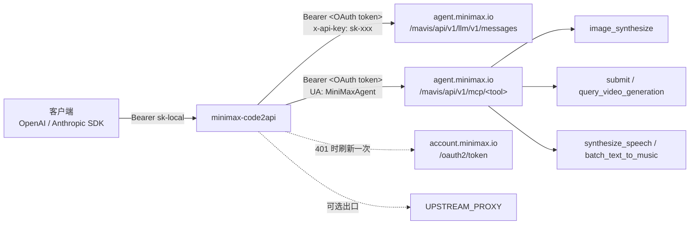

# minimax-code2api

把 **MiniMax Code 桌面端（Coding Plan 额度）** 变成标准的 HTTP 接口，同时提供
**OpenAI Chat Completions** 和 **Anthropic Messages** 两种协议。任何能配
`base_url` + `api_key` 的客户端都能直接接进来，不用改代码。

- 一个进程，两个协议：`/v1/chat/completions`（OpenAI）、`/v1/messages`（Anthropic）
- 流式、工具调用（function calling）、思考内容（`reasoning_content`）全支持
- 6 个可用模型，**含 100 万上下文**的 M3 / M3.1-Flash
- **多模态同一条通道**：文生图、文/图生视频、TTS、音乐，一起变成 HTTP 接口
- 无状态、单容器、可 Docker 部署；token 到期自动续期

---

## 一、它用的是什么通道

不是 MiniMax 开放平台的 API Key，而是桌面端登录后的 **托管通道**（managed-login）。

| 项目 | 事实 | 依据 |
|---|---|---|
| 上游协议 | Anthropic Messages（不是 OpenAI） | 客户端 `config.yaml`：`@ai-sdk/anthropic` |
| 上游地址 | `https://agent.minimax.io/mavis/api/v1/llm/v1` | 同上，`en-prod` 预设 |
| 鉴权 | `Authorization: Bearer <OAuth accessToken>` **且** `x-api-key: sk-xxx` | 反编译 `local-model-resolver.js`，实测通过 |
| `x-api-key` 为什么是 `sk-xxx` | 这是客户端写死的占位符，缺了会返回 `token is required` | `MANAGED_PROVIDER_API_KEY_PLACEHOLDER` |
| Token 来源 | 设备码 OAuth，`client_id=mcode-public`，`scope=agent.default`，`audience=agent-backend` | `@mavis/oauth-core`，已在本机复现 |
| Token 有效期 | 12 小时，带 refresh token 可续 | `auth.json` 的 `expiresAtMs` |
| 计费 | 走账号 Credits，**不是按 token 计费的 API 额度** | 桌面端左下角 Credits 余额 |

### 可用模型（2026-11-11 逐个实测）

| 模型 | 上下文 | 最大输出 | 视觉 | 思考 |
|---|---|---|---|---|
| `MiniMax-M3.1-Flash` | 1,000,000 | 524,288 | ✅ | 强制开启 |
| `MiniMax-M3` | 1,000,000 | 524,288 | ✅ | 可切换 |
| `MiniMax-M2.7` | 204,800 | 131,072 | — | 可切换 |
| `MiniMax-M2.7-highspeed` | 204,800 | 131,072 | — | 可切换 |
| `MiniMax-M2.5` | 204,800 | 131,072 | — | 可切换 |
| `MiniMax-M2.5-highspeed` | 204,800 | 131,072 | — | 可切换 |
| ~~`MiniMax-M2`~~ / ~~`MiniMax-M2.1`~~ | — | — | — | 上游已下线（错误码 2069） |

别名可用：`m3`、`m3.1`、`m2.7`、`m2.5`、`minimax`、`default`。

### 多模态能力（同一条通道，另一组端点）

| 能力 | 上游工具 | 网关端点 | 实测状态 |
|---|---|---|---|
| 文生图 / 图生图 | `image_synthesize` | `POST /v1/images/generations` | ✅ 200，1 张 1K 约 20 秒 |
| 文生视频 / 图生视频 | `submit_video_generation` + `query_video_generation` | `POST /v1/videos/generations` | ✅ 提交成功（202 + task_id），查询状态流转 `running → succeeded`；**文件交付环节见 §3.7** |
| 语音合成 | `synthesize_speech` | `POST /v1/audio/speech` | 端点与参数已验证；实测时余额已耗尽（402） |
| 音色列表 | `get_voice_list` | `GET /v1/audio/voices` | ✅ 200，332 个音色 |
| 音乐 / BGM | `batch_text_to_music` | `POST /v1/music/generations` | 端点与参数已验证；同上受余额限制 |
| 图片 / 视频 / 音频理解 | `images_understand` 等 | 暂未封装 | 上游要的是本地 workspace 路径，需先做文件上传，见下方边界 |

视频模型：`MiniMax-H3`、`MiniMax-Hailuo-2.3`。

---

## 二、30 秒跑起来（本机已登录桌面端）

```bash
git clone <this-repo> && cd minimax-code2api
python -m venv .venv && .venv/bin/pip install -r requirements.txt   # Windows: .venv\Scripts\pip

GATEWAY_API_KEY=sk-local .venv/bin/python -m uvicorn app.main:app --host 0.0.0.0 --port 8080
```

macOS / Linux 会自动读取桌面端的 `~/.minimax/auth/prod/en/mcode-public/auth.json`，
**不需要手动复制 token**。桌面端每次刷新 token，网关下一次请求就跟着用新的。

```bash
curl -s http://127.0.0.1:8080/v1/chat/completions \
  -H "Authorization: Bearer sk-local" -H "Content-Type: application/json" \
  -d '{"model":"MiniMax-M3.1-Flash","messages":[{"role":"user","content":"你好"}]}'
```

服务器部署请看 **[DEPLOY.md](DEPLOY.md)**（含出口网络要求、Docker、反代、排障）。

---

## 二点五、多账号池（多份额度轮着用）

一个账号的额度有限。网关支持把多个账号放进 `TOKEN_POOL`，请求按轮询分摊，
某个号 401/402/429 就自动停用一段时间再换下一个，不会把整个网关拖死。

### 建池

邮箱 + 密码即可，**不需要浏览器、不需要验证码、不需要邮箱收信**：

```bash
# 单个账号
python -m app.provision --email someone@mail.example --password 'secret'

# 批量：accounts.txt 每行 "邮箱<tab>密码"（空格分隔也行）
python -m app.provision --file accounts.txt

# 手工续期池里所有 token（平时不用跑，网关会自己续）
python -m app.provision --refresh
```

生成的文件长这样，一个账号一个文件：

```json
{
  "region": "en",
  "email": "someone@mail.example",
  "username": "MiniMax322212",
  "user_id": "576841688080293888",
  "group_id": "2120731921469153576",
  "accessToken": "mmoat_...",
  "refreshToken": "mmort_...",
  "expiresAtMs": 1794511512549
}
```

> `refreshToken` 每次续期都会轮换，网关会就地写回文件，**不要手工拷贝旧值**。

### 启动

```bash
TOKEN_POOL=./data/tokens UPSTREAM_PROXY=http://127.0.0.1:7890 \
GATEWAY_API_KEY=sk-local python -m uvicorn app.main:app --port 8080
```

### 看池状态

`GET /healthz` 不返回任何 token，只报每个账号是否可用、用了几次、冷却多久：

```bash
curl -s http://127.0.0.1:8080/healthz | python -m json.tool
```

```json
{
  "status": "ok",
  "pool_size": 8,
  "accounts": [
    {"label": "someone@mail.example", "usable": true, "uses": 12,
     "cooling_for": 0, "last_error": null}
  ]
}
```

### 失效行为

| 上游返回 | 网关动作 |
|---|---|
| `401` | 先尝试刷新一次；仍失败则停用该账号 10 分钟，换下一个 |
| `402` / `429` | 停用 15 分钟 / 1 分钟，换下一个 |
| `400 unknown model` | 该号没有这个模型的权限，换下一个账号重试 |
| `307` 跳转 | 直接报配置错误，提示换出口代理（跳转会丢 Authorization） |

全池都不可用时才返回 `502`。所有账号的 `accessToken` 12 小时过期，但有
`refreshToken` 兜底，长期不用管。

---

## 二点六、每日签到（唯一的免费加额度方式）

账号余额用完就是 `402`，唯一不花钱的回血途径是**每日签到**。规则（2026-11-12 实测）：

| 项 | 值 |
|---|---|
| 单日奖励 | 400 积分（第 4 天、第 7 天各 1000） |
| 一轮 | 7 天，合计 **4000 积分** |
| 有效期 | 领到手起 **30 天** |
| 用途 | **仅限 MiniMax Code** 消耗，不能用于开放平台 API |
| 接口 | `GET /minimax-cloud/api/v1/signin/status` / `POST .../signin/claim`，域名 `agent.minimax.io` |

网关**默认每次启动都会替池子里所有账号签到**，之后每 6 小时补一次（幂等，
签过就跳过），日志里能看到：

```
daily check-in: 7/8 accounts, +2800 credits
```

手动跑或只是想看进度：

```bash
python -m app.signin --dir data/tokens            # 直接签到
python -m app.signin --dir data/tokens --status   # 只看状态，不领
```

```
aaa@mail.example.com            day 1 claimed   cycle=4000 pts
bbb@mail.example.com            day 1 claimable cycle=4000 pts

8 account(s), 2800 credits still claimable this cycle
```

关键点：`timezone_id` 必须是 IANA 名字（`Asia/Shanghai`），传偏移量 `480` 会被服务端
以 `1406010011 invalid timezone_id` 拒绝——这个坑没有文档，只有前端 bundle 里能看出来。

**规模效应**：8 个账号 × 4000/周 = **3.2 万积分/周**，足够抵消日常刷请求的消耗。
这也是多账号池真正的价值所在：单号每天 400 不够用，八个号一起签到才够。

---

## 三、接口

### 3.1 OpenAI 协议

```
POST /v1/chat/completions
GET  /v1/models
```

```bash
# 流式
curl -N http://127.0.0.1:8080/v1/chat/completions \
  -H "Authorization: Bearer sk-local" -H "Content-Type: application/json" \
  -d '{
    "model": "MiniMax-M3.1-Flash",
    "stream": true,
    "messages": [{"role": "user", "content": "数到 3"}]
  }'
```

OpenAI 官方 SDK（只改两个值）：

```python
from openai import OpenAI

client = OpenAI(base_url="http://127.0.0.1:8080/v1", api_key="sk-local")
resp = client.chat.completions.create(
    model="MiniMax-M3",
    messages=[{"role": "user", "content": "用一句话解释 HTTP/2"}],
)
print(resp.choices[0].message.content)
```

工具调用：

```python
tools = [{
    "type": "function",
    "function": {
        "name": "get_weather",
        "description": "查询城市天气",
        "parameters": {"type": "object", "properties": {"city": {"type": "string"}}, "required": ["city"]},
    },
}]
resp = client.chat.completions.create(
    model="MiniMax-M3",
    messages=[{"role": "user", "content": "深圳天气怎么样？"}],
    tools=tools,
)
print(resp.choices[0].message.tool_calls[0].function)
# function(name='get_weather', arguments='{"city": "Shenzhen"}')
```

思考内容在 `choices[0].message.reasoning_content`，和正文分开，不会污染 `content`。

### 3.2 Anthropic 协议

```
POST /v1/messages
```

模型输出的 `thinking` 块原样保留，所以 Claude Code、Cline 这类客户端能直接看到思考过程。

```bash
curl -s http://127.0.0.1:8080/v1/messages \
  -H "Authorization: Bearer sk-local" -H "Content-Type: application/json" \
  -d '{"model":"MiniMax-M3","max_tokens":256,"messages":[{"role":"user","content":"你好"}]}'
```

```python
from anthropic import Anthropic

client = Anthropic(base_url="http://127.0.0.1:8080", api_key="sk-local")
msg = client.messages.create(
    model="MiniMax-M3.1-Flash",
    max_tokens=256,
    messages=[{"role": "user", "content": "你好"}],
)
print(msg.content[0].text)
```

接入 Claude Code 之类的工具：

```bash
export ANTHROPIC_BASE_URL=http://127.0.0.1:8080
export ANTHROPIC_AUTH_TOKEN=sk-local
export ANTHROPIC_MODEL=MiniMax-M3
export ANTHROPIC_SMALL_FAST_MODEL=MiniMax-M3.1-Flash
```

### 3.3 运维端点

| 端点 | 说明 |
|---|---|
| `GET /` | 名称、端点清单、模型列表（不需要 key） |
| `GET /healthz` | 200 = 有可用凭证；503 = 缺凭证，附原因 |
| `GET /v1/models` | OpenAI 格式模型列表；加 `?include_media=true` 连多模态一起列 |
| `GET /v1/models/meta` | 带上下文长度、能力标记 |
| `GET /v1/media/models` | 多模态能力清单（参数范围、对应端点） |
| `POST /v1/messages/count_tokens` | 粗估 token 数（上游不开放 tokenizer） |

### 3.4 文生图

```
POST /v1/images/generations
```

OpenAI 同样式的请求体，只改 `base_url` 就能用现成的图片客户端。

```bash
curl -s http://127.0.0.1:8080/v1/images/generations \
  -H "Authorization: Bearer sk-local" -H "Content-Type: application/json" \
  -d '{"prompt":"a red apple on a white table, product photo","n":1,"size":"1024x1024"}'
```

```json
{
  "created": 1794452319,
  "data": [{"url": "https://agent-cdn.minimax.io/mcp/u576.../image_tool/output/1794452319_8d06712a.png"}],
  "model": "image"
}
```

| 参数 | 说明 |
|---|---|
| `prompt` | 必填 |
| `n` | 1–10，一次调用内部批量生成 |
| `size` | `1024x1024`、`1792x1024` 等。网关把它换算成上游的 `aspect_ratio` + `resolution` |
| `resolution` | 直接指定 `1K` / `2K` / `4K`（覆盖 `size` 推导结果） |
| `aspect_ratio` | 直接指定 `16:9`、`1:1`、`9:16` 等（覆盖 `size` 推导结果） |
| `reference_images` | 参考图 URL 数组，最多 4 张（图生图） |
| `response_format` | `url`（默认，直接给 CDN 链接）或 `b64_json`（网关下载后转 base64） |

⚠️ **实测发现**：返回的 URL 后缀是 `.png`、CDN 的 `Content-Type` 也是 `image/png`，
但**实际字节是 JPEG**（`ff d8 ff e1`，带 AIGC 水印 Exif）。这是上游工具的行为，网关无法改。
按扩展名或 Content-Type 判断格式的程序会被误导——**靠文件头判断**。

### 3.5 文生视频 / 图生视频

视频是**异步**的：提交拿 `task_id`，再轮询。上游没有 OpenAI 式的视频协议，这里用 REST 风格自定义。

```bash
# 1) 提交
curl -s http://127.0.0.1:8080/v1/videos/generations \
  -H "Authorization: Bearer sk-local" -H "Content-Type: application/json" \
  -d '{"model":"MiniMax-Hailuo-2.3","prompt":"a cat walking on grass","duration":6,"resolution":"768P"}'
# → 202 {"id":"462436026450282","status":"submitted","model":"MiniMax-Hailuo-2.3", ...}

# 2) 轮询（model 必须和提交时一致）
curl -s "http://127.0.0.1:8080/v1/videos/generations/462436026450282?model=MiniMax-Hailuo-2.3" \
  -H "Authorization: Bearer sk-local"
# → {"status":"running", ...} → {"status":"succeeded","video_url":"https://..."}
```

| 模型 | 时长 | 分辨率 | 特点 |
|---|---|---|---|
| `MiniMax-H3` | 4–15 秒（整数） | `768P` / `2K` | 原生同步音频，支持首尾帧 + 多模态参考（图 1-9、视频 1-3、音频 1-3） |
| `MiniMax-Hailuo-2.3` | 仅 `6` 或 `10` 秒 | `768P` / `1080P` | 只吃一张首帧图，便宜 |

请求字段：

| 字段 | 说明 |
|---|---|
| `prompt` | 必填，≤7000 字符 |
| `image` | 首帧图（公网 URL）。MiniMax-Hailuo-2.3 只接受一张 |
| `last_frame_image` | 尾帧图，**仅 H3** |
| `reference_images` / `reference_videos` / `reference_audios` | **仅 H3**，公网 URL 数组 |
| `ratio` | `21:9 16:9 4:3 1:1 3:4 9:16 adaptive`；H3 纯文本模式不接受 `adaptive` |
| `resolution` | H3 默认 `2K`；Hailuo 默认 `768P`（10 秒只能 768P） |

#### 多账号池下的两个坑（网关已处理）

1. **视频权限是按账号给的**，不是按 API key。同一份代码、同一个模型，8 个号里
   只有 1 个能提交成功，其余返回
   `{"code":503,"message":"video generation is temporarily unavailable"}` ——
   这句 "temporarily unavailable" 会让人以为是上游故障，其实是**这个号没有视频能力**。
   网关遇到 `503` 会自动换下一个账号重试（生图 / TTS / 音乐同理，只有
   `query_video_generation` 的 503 才是真的"文件还没备好"，不换号）。
2. **异步任务属于提交它的那个账号**。用别的号去查，即使 `task_id` 完全正确也会回
   `404 task was not found or does not belong to the current caller`。
   网关在进程内记住 `task_id → 账号` 的映射，轮询时钉住原账号。

> 由此带来的限制：`task_id` 的归属只存在内存里，**重启网关后旧任务就查不了了**
> （会回 404 并在 `hint` 里说明）。要长期可查，得把映射落盘。

另外实测这条通道的视频**只渲染不交付**：状态会正常走到 `running` 然后变
`503 the video is ready but could not be prepared for delivery`，连查 5 分钟都拿不到
`video_url`。这不是网关问题，是上游没把文件备到可下载位置 —— 继续查同一个 `task_id`，
**不要重新提交**（会再扣一次 320 credits）。

### 3.6 语音合成 / 音乐

```bash
# 音色列表（332 个）
curl -s http://127.0.0.1:8080/v1/audio/voices -H "Authorization: Bearer sk-local"

# TTS，直接返回 mp3 字节流（OpenAI /v1/audio/speech 同样式）
curl -s http://127.0.0.1:8080/v1/audio/speech \
  -H "Authorization: Bearer sk-local" -H "Content-Type: application/json" \
  -d '{"input":"hello world","voice":"English_expressive_narrator","speed":1.0}' > out.mp3

# 音乐 / BGM（prompt 长度 10–300 字符）
curl -s http://127.0.0.1:8080/v1/music/generations \
  -H "Authorization: Bearer sk-local" -H "Content-Type: application/json" \
  -d '{"prompt":"upbeat lofi hip hop with warm piano, 90 bpm"}'
```

TTS 额外支持 `emotion`（`happy` / `sad` / `angry` / `fearful` / `disgusted` / `surprised` / `neutral`）、
`volume`、`pitch`。**只输出 mp3**：上游不提供其它容器格式，要 `wav` 请自行转码。

### 3.7 多模态的错误语义

上游把业务码塞在 HTTP 200 里，网关把它们翻成真正的 HTTP 状态，并**原样保留上游文案**：

| 上游 `code` | 网关 HTTP | 含义 | 能做什么 |
|---|---|---|---|
| `402` | 402 | 账号额度耗尽（文案会明确说 plan balance has run out） | 充值，重试无用 |
| `503`（视频查询） | 503 + `status: succeeded` + `retryable: true` | 任务已渲染完成，但服务端没备好文件交付 | 继续轮询同一个 `task_id`，**不要重新提交** |
| `401` | 401 | token 失效 | 网关会自动刷新一次 |

视频任务的 `status` 取值：`submitted` / `queued` / `running` / `succeeded` / `failed` / `cancelled`。

---

## 四、请求链路



网关本身无状态：凭证只从环境变量 / `token.json` / 桌面端 `auth.json` 读，不落日志、不下发。

---

## 五、环境变量

| 变量 | 默认 | 说明 |
|---|---|---|
| `GATEWAY_API_KEY` | 空 | 调用方要带的 key，逗号分隔多个。**公网部署必须设** |
| `MINIMAX_REGION` | `en` | `en`（国际站）或 `cn`（国内站） |
| `UPSTREAM_PROXY` | 空 | 上游出口代理。**国内网络必须设**，见 DEPLOY.md 第一节 |
| `UPSTREAM_TRANSPORT` | `auto` | `auto` / `httpx` / `curl`。出口代理会重置 Python TLS 握手时用 `curl` |
| `TOKEN_POOL` | 空 | **多账号池目录**，一个账号一个 json。设了就优先用它轮询 |
| `SIGNIN_AUTO` | `1` | 有 `TOKEN_POOL` 时每次启动 + 每 6 小时自动签到领积分 |
| `SIGNIN_TIMEZONE` | `Asia/Shanghai` | 签到时区，必须是 IANA 名字，不能是 `480` 这种偏移 |
| `SIGNIN_INTERVAL_HOURS` | `6` | 自动签到的检查间隔（最小 10 分钟） |
| `MINIMAX_ACCESS_TOKEN` | 空 | 直接给一个 access token（约 12h 失效） |
| `MINIMAX_REFRESH_TOKEN` | 空 | 只给 refresh token，网关自己续期 |
| `TOKEN_STORE` | `/data/token.json` | 网关自己管理的 token 文件，会就地刷新 |
| `MINIMAX_AUTH_FILE` | 自动探测 | 桌面端 `auth.json` 路径 |
| `MINIMAX_BASE_URL` | 按区域 | 上游 LLM 地址 |
| `MINIMAX_MCP_BASE` | 由 `MINIMAX_BASE_URL` 推导 | 上游多模态 MCP 代理地址，默认把 `/llm/v1` 换成 `/mcp` |
| `DEFAULT_MAX_TOKENS` | `8192` | 客户端没传 `max_tokens` 时用 |
| `UPSTREAM_TIMEOUT` | `600` | 上游超时（秒） |
| `REQUEST_BODY_LIMIT` | 64 MiB | 请求体上限 |
| `EXPOSE_RETIRED_MODELS` | `0` | 设为 1 时把已下线模型也列出来 |

---

## 六、常见问题

| 现象 | 原因 | 处理 |
|---|---|---|
| `307` 后接 `401 invalid access token` | 出口 IP 被地理重定向到旧的 `agent.minimaxi.com`，重定向会丢掉 `Authorization` | 配 `UPSTREAM_PROXY` 走能直达 `agent.minimax.io` 的出口 |
| `{"code":401,"message":"token is required"}` | `x-api-key` 缺失（必须是占位符 `sk-xxx`） | 用本仓库，别手搓请求 |
| `404 ... no longer available (2069)` | 模型已下线（M2 / M2.1） | 换 M2.5 及以上 |
| `503` on `/healthz` | 没有可用凭证 | 用 `python -m app.login` 登录，或挂载 `auth.json` |
| 流式到一半断 | 反代缓冲或读超时 | nginx 关 `proxy_buffering`，`proxy_read_timeout` 拉长 |
| 生图 / TTS 返回 `402` | 账号额度耗尽，文案里会写 `plan balance has run out` | 桌面端充值；**重试无效** |
| 视频查询 `503` 但 `status: succeeded` | 任务渲染完成，服务端没备好文件交付 | 隔几分钟轮询同一 `task_id`；不要重新提交（会再扣一次） |
| 视频提交 `503 temporarily unavailable` | **该账号没有视频权限**，不是上游故障 | 仓库池里有别的号能提交就行，网关会自动换号；全池都没有就充 M Plan |
| 视频查询 `404 does not belong to the current caller` | 提交和查询用到了不同账号；或网关重启丢了映射 | 用同一个网关实例查；重启后再查只能重新提交 |
| 生图返回的 `.png` 打不开 / 格式不对 | 字节其实是 JPEG，只是名字和 Content-Type 写成了 png | 按文件头（`ff d8`）判断格式 |
| 视频提交 `402` + `this task costs N credits` | 余额不够这一单 | 充值，或换 `MiniMax-Hailuo-2.3`（比 H3 便宜） |
| `reference_images` 不生效 | 参考图必须是**公网可达 URL**，本地路径网关读不到 | 先上传到图床 / OSS 再传 URL |
| Credits 用完 | 这是账号额度，不是 API 配额 | 桌面端充值，或换官方开放平台 Key |
| SDK 报 `404` + `{"detail":"Not Found"}`，但 `curl` 同一条 URL 正常 | 环境里有 `HTTP_PROXY`，httpx 连 `127.0.0.1` 也走代理，请求行变成 `POST http://127.0.0.1:8099/v1/...`，框架把整串当路径 | 已内置中间件把它还原成 origin-form；旧版本请给客户端设 `NO_PROXY=127.0.0.1,localhost` |
| 池子里某个号一直不被使用 | 该号没有对应模型的权限，`400 unknown model` 后被自动跳过 | 正常，看 `/healthz` 的 `last_error` |
| 签到报 `1406010011 invalid timezone_id` | `SIGNIN_TIMEZONE` 写成了偏移量 | 改成 IANA 名字，如 `Asia/Shanghai` |
| 签到成功但仍 `402` | 积分 30 天有效、仅限 MiniMax Code，且一天只 400 | 多号分摊或充值；单号靠签到撑不住高并发 |
| 日志里 `ConnectError [WinError 10054]` / `SSL: UNEXPECTED_EOF_WHILE_READING` | 出口代理只放行 Windows schannel 指纹，拒绝 Python/OpenSSL 握手 | 保持 `UPSTREAM_TRANSPORT=auto`，会自动退回 curl（镜像已装 curl） |

---

## 七、测试

```bash
python tests/test_smoke.py          # 无网络，翻译层单元测试，CI 会跑
python tests/test_media.py          # 无网络，多模态参数换算与错误映射
GATEWAY=http://127.0.0.1:8080 GATEWAY_KEY=sk-local \
  python tests/test_sdk_compat.py   # 需要真实凭证，跑官方 openai / anthropic SDK

# 多模态实测：默认只查免费的 models / voices
GATEWAY=http://127.0.0.1:8080 GATEWAY_KEY=sk-local \
  python tests/test_media_live.py
# 加上生图 / TTS / 音乐（会真实扣积分），视频另开（一次 320 credits 起）
MEDIA_LIVE=1 MEDIA_LIVE_VIDEO=1 GATEWAY=... GATEWAY_KEY=... \
  python tests/test_media_live.py
```

---

## 八、边界与风险

- **个人额度通道**，不是商业 API。并发高会撞账号限流，Credits 按量扣。
- **生图 / 视频 / TTS / 音乐各自计费**，和聊天额度是同一条 account credits 池（视频另可能走 M Plan 周额度）。
  一次 H3 4 秒视频实测报价 **320 credits**，比聊天贵得多。
- **参考图必须是公网 URL**。桌面端是先上传本地文件到 OSS 再把签名 URL 传给上游；网关不做这一步，
  所以 `reference_images` / `image` / `last_frame_image` 目前只接受 HTTP(S) 地址。
  要把本地文件也支持上，需要补 `get_upload_url` + PUT 的上传流程（上游接口已知，见 `image-tools.client.js`）。
- **生图/视频结果是 CDN 链接**，不是网关切下来存的字节。链接会过期（H3 签名 URL 约 9 小时），
  需要长期保存请自己转存。
- **非官方接口**，MiniMax 改协议就可能失效。好消息是出错会明确报错，不会静默降级。
- **凭证即账号**：`auth.json` / `token.json` 泄露等于账号被别人用。不要提交进 git。
- 本项目只做协议转换与凭证管理，**不绕过任何计费**。

## License

MIT
