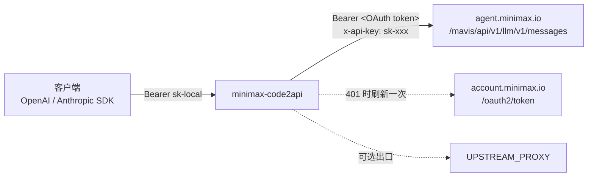

# minimax-code2api

把 **MiniMax Code 桌面端（Coding Plan 额度）** 变成标准的 HTTP 接口，同时提供
**OpenAI Chat Completions** 和 **Anthropic Messages** 两种协议。任何能配
`base_url` + `api_key` 的客户端都能直接接进来，不用改代码。

- 一个进程，两个协议：`/v1/chat/completions`（OpenAI）、`/v1/messages`（Anthropic）
- 流式、工具调用（function calling）、思考内容（`reasoning_content`）全支持
- 6 个可用模型，**含 100 万上下文**的 M3 / M3.1-Flash
- 无状态、单容器、可 Docker 部署；token 到期自动续期

---

## 一、它用的是什么通道

不是 MiniMax 开放平台的 API Key，而是桌面端登录后的 **托管通道**（managed-login）。

| 项目 | 事实 | 依据 |
|---|---|---|
| 上游协议 | Anthropic Messages（不是 OpenAI） | 客户端 `config.yaml`：`@ai-sdk/anthropic` |
| 上游地址 | `https://agent.minimax.io/mavis/api/v1/llm/v1` | 同上，`en-prod` 预设 |
| 鉴权 | `Authorization: Bearer <OAuth accessToken>` **且** `x-api-key: sk-xxx` | 反编译 `local-model-resolver.js`，实测通过 |
| `x-api-key` 为什么是 `sk-xxx` | 这是客户端写死的占位符，缺了会返回 `token is required` | `MANAGED_PROVIDER_API_KEY_PLACEHOLDER` |
| Token 来源 | 设备码 OAuth，`client_id=mcode-public`，`scope=agent.default`，`audience=agent-backend` | `@mavis/oauth-core`，已在本机复现 |
| Token 有效期 | 12 小时，带 refresh token 可续 | `auth.json` 的 `expiresAtMs` |
| 计费 | 走账号 Credits，**不是按 token 计费的 API 额度** | 桌面端左下角 Credits 余额 |

### 可用模型（2026-11-11 逐个实测）

| 模型 | 上下文 | 最大输出 | 视觉 | 思考 |
|---|---|---|---|---|
| `MiniMax-M3.1-Flash` | 1,000,000 | 524,288 | ✅ | 强制开启 |
| `MiniMax-M3` | 1,000,000 | 524,288 | ✅ | 可切换 |
| `MiniMax-M2.7` | 204,800 | 131,072 | — | 可切换 |
| `MiniMax-M2.7-highspeed` | 204,800 | 131,072 | — | 可切换 |
| `MiniMax-M2.5` | 204,800 | 131,072 | — | 可切换 |
| `MiniMax-M2.5-highspeed` | 204,800 | 131,072 | — | 可切换 |
| ~~`MiniMax-M2`~~ / ~~`MiniMax-M2.1`~~ | — | — | — | 上游已下线（错误码 2069） |

别名可用：`m3`、`m3.1`、`m2.7`、`m2.5`、`minimax`、`default`。

---

## 二、30 秒跑起来（本机已登录桌面端）

```bash
git clone <this-repo> && cd minimax-code2api
python -m venv .venv && .venv/bin/pip install -r requirements.txt   # Windows: .venv\Scripts\pip

GATEWAY_API_KEY=sk-local .venv/bin/python -m uvicorn app.main:app --host 0.0.0.0 --port 8080
```

macOS / Linux 会自动读取桌面端的 `~/.minimax/auth/prod/en/mcode-public/auth.json`，
**不需要手动复制 token**。桌面端每次刷新 token，网关下一次请求就跟着用新的。

```bash
curl -s http://127.0.0.1:8080/v1/chat/completions \
  -H "Authorization: Bearer sk-local" -H "Content-Type: application/json" \
  -d '{"model":"MiniMax-M3.1-Flash","messages":[{"role":"user","content":"你好"}]}'
```

服务器部署请看 **[DEPLOY.md](DEPLOY.md)**（含出口网络要求、Docker、反代、排障）。

---

## 三、接口

### 3.1 OpenAI 协议

```
POST /v1/chat/completions
GET  /v1/models
```

```bash
# 流式
curl -N http://127.0.0.1:8080/v1/chat/completions \
  -H "Authorization: Bearer sk-local" -H "Content-Type: application/json" \
  -d '{
    "model": "MiniMax-M3.1-Flash",
    "stream": true,
    "messages": [{"role": "user", "content": "数到 3"}]
  }'
```

OpenAI 官方 SDK（只改两个值）：

```python
from openai import OpenAI

client = OpenAI(base_url="http://127.0.0.1:8080/v1", api_key="sk-local")
resp = client.chat.completions.create(
    model="MiniMax-M3",
    messages=[{"role": "user", "content": "用一句话解释 HTTP/2"}],
)
print(resp.choices[0].message.content)
```

工具调用：

```python
tools = [{
    "type": "function",
    "function": {
        "name": "get_weather",
        "description": "查询城市天气",
        "parameters": {"type": "object", "properties": {"city": {"type": "string"}}, "required": ["city"]},
    },
}]
resp = client.chat.completions.create(
    model="MiniMax-M3",
    messages=[{"role": "user", "content": "深圳天气怎么样？"}],
    tools=tools,
)
print(resp.choices[0].message.tool_calls[0].function)
# function(name='get_weather', arguments='{"city": "Shenzhen"}')
```

思考内容在 `choices[0].message.reasoning_content`，和正文分开，不会污染 `content`。

### 3.2 Anthropic 协议

```
POST /v1/messages
```

模型输出的 `thinking` 块原样保留，所以 Claude Code、Cline 这类客户端能直接看到思考过程。

```bash
curl -s http://127.0.0.1:8080/v1/messages \
  -H "Authorization: Bearer sk-local" -H "Content-Type: application/json" \
  -d '{"model":"MiniMax-M3","max_tokens":256,"messages":[{"role":"user","content":"你好"}]}'
```

```python
from anthropic import Anthropic

client = Anthropic(base_url="http://127.0.0.1:8080", api_key="sk-local")
msg = client.messages.create(
    model="MiniMax-M3.1-Flash",
    max_tokens=256,
    messages=[{"role": "user", "content": "你好"}],
)
print(msg.content[0].text)
```

接入 Claude Code 之类的工具：

```bash
export ANTHROPIC_BASE_URL=http://127.0.0.1:8080
export ANTHROPIC_AUTH_TOKEN=sk-local
export ANTHROPIC_MODEL=MiniMax-M3
export ANTHROPIC_SMALL_FAST_MODEL=MiniMax-M3.1-Flash
```

### 3.3 运维端点

| 端点 | 说明 |
|---|---|
| `GET /` | 名称、端点清单、模型列表（不需要 key） |
| `GET /healthz` | 200 = 有可用凭证；503 = 缺凭证，附原因 |
| `GET /v1/models` | OpenAI 格式模型列表 |
| `GET /v1/models/meta` | 带上下文长度、能力标记 |
| `POST /v1/messages/count_tokens` | 粗估 token 数（上游不开放 tokenizer） |

---

## 四、请求链路



网关本身无状态：凭证只从环境变量 / `token.json` / 桌面端 `auth.json` 读，不落日志、不下发。

---

## 五、环境变量

| 变量 | 默认 | 说明 |
|---|---|---|
| `GATEWAY_API_KEY` | 空 | 调用方要带的 key，逗号分隔多个。**公网部署必须设** |
| `MINIMAX_REGION` | `en` | `en`（国际站）或 `cn`（国内站） |
| `UPSTREAM_PROXY` | 空 | 上游出口代理。**国内网络必须设**，见 DEPLOY.md 第一节 |
| `MINIMAX_ACCESS_TOKEN` | 空 | 直接给一个 access token（约 12h 失效） |
| `MINIMAX_REFRESH_TOKEN` | 空 | 只给 refresh token，网关自己续期 |
| `TOKEN_STORE` | `/data/token.json` | 网关自己管理的 token 文件，会就地刷新 |
| `MINIMAX_AUTH_FILE` | 自动探测 | 桌面端 `auth.json` 路径 |
| `MINIMAX_BASE_URL` | 按区域 | 上游 LLM 地址 |
| `DEFAULT_MAX_TOKENS` | `8192` | 客户端没传 `max_tokens` 时用 |
| `UPSTREAM_TIMEOUT` | `600` | 上游超时（秒） |
| `REQUEST_BODY_LIMIT` | 64 MiB | 请求体上限 |
| `EXPOSE_RETIRED_MODELS` | `0` | 设为 1 时把已下线模型也列出来 |

---

## 六、常见问题

| 现象 | 原因 | 处理 |
|---|---|---|
| `307` 后接 `401 invalid access token` | 出口 IP 被地理重定向到旧的 `agent.minimaxi.com`，重定向会丢掉 `Authorization` | 配 `UPSTREAM_PROXY` 走能直达 `agent.minimax.io` 的出口 |
| `{"code":401,"message":"token is required"}` | `x-api-key` 缺失（必须是占位符 `sk-xxx`） | 用本仓库，别手搓请求 |
| `404 ... no longer available (2069)` | 模型已下线（M2 / M2.1） | 换 M2.5 及以上 |
| `503` on `/healthz` | 没有可用凭证 | 用 `python -m app.login` 登录，或挂载 `auth.json` |
| 流式到一半断 | 反代缓冲或读超时 | nginx 关 `proxy_buffering`，`proxy_read_timeout` 拉长 |
| Credits 用完 | 这是账号额度，不是 API 配额 | 桌面端充值，或换官方开放平台 Key |

---

## 七、测试

```bash
python tests/test_smoke.py          # 无网络，翻译层单元测试，CI 会跑
GATEWAY=http://127.0.0.1:8080 GATEWAY_KEY=sk-local \
  python tests/test_sdk_compat.py   # 需要真实凭证，跑官方 openai / anthropic SDK
```

---

## 八、边界与风险

- **个人额度通道**，不是商业 API。并发高会撞账号限流，Credits 按量扣。
- **非官方接口**，MiniMax 改协议就可能失效。好消息是出错会明确报错，不会静默降级。
- **凭证即账号**：`auth.json` / `token.json` 泄露等于账号被别人用。不要提交进 git。
- 本项目只做协议转换与凭证管理，**不绕过任何计费**。

## License

MIT
